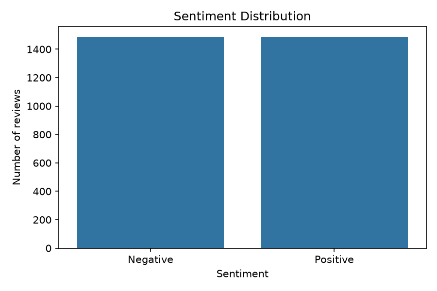
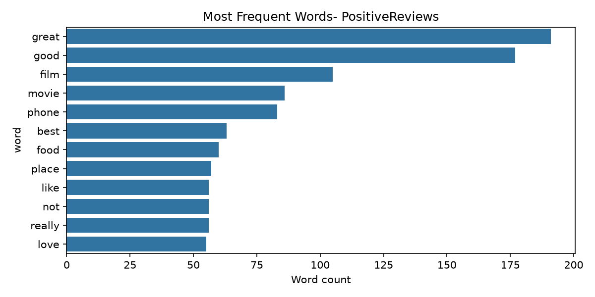
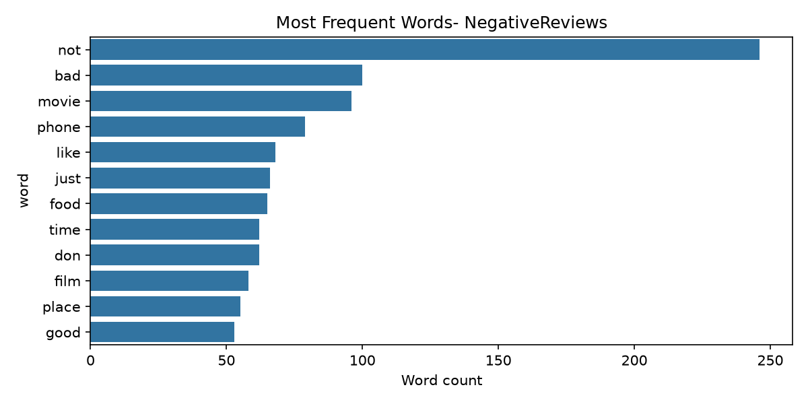
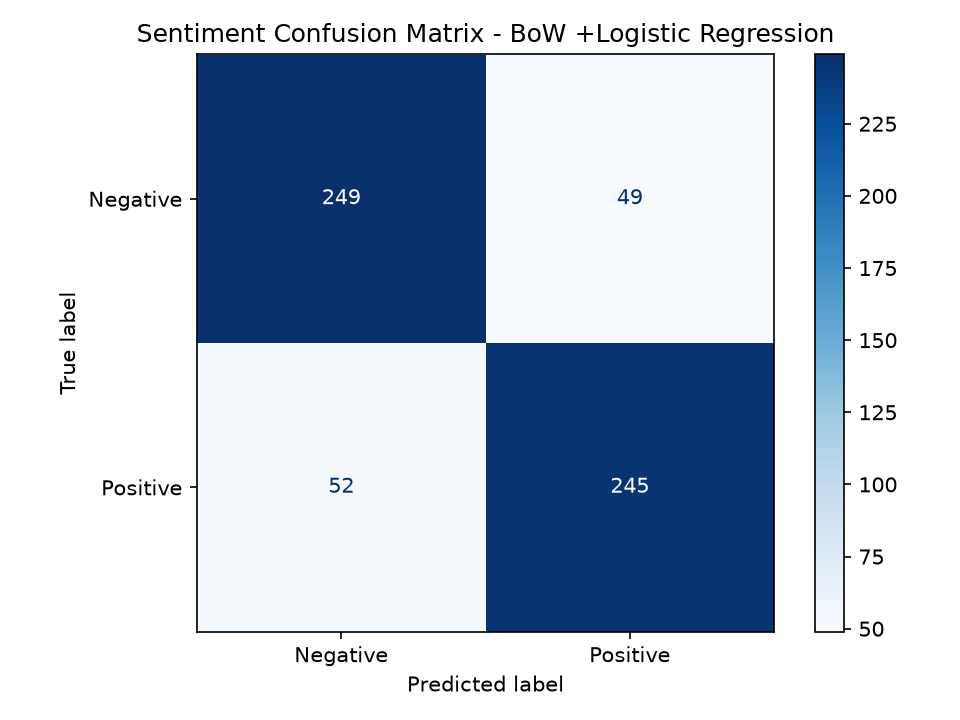
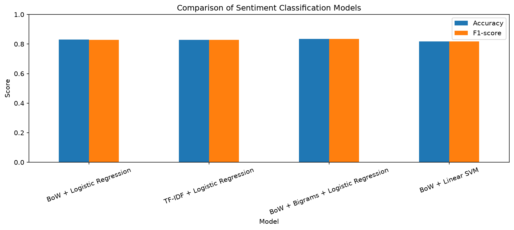

# Lab 01 — Sentiment Analysis Using Traditional Machine Learning

**Module:** PUSL3205 — Large Language Models and Generative AI  
**Assessment:** P1 — Individual Practical Portfolio  
**Lab sheet:** Lab 01, *Sentiment Analysis Using Traditional Machine Learning*  
**Language:** Python (Jupyter Notebook)  
**Libraries:** Pandas, NumPy, Scikit-learn, Matplotlib, Seaborn (and Python's `re` and `csv` modules)  
**Dataset:** [UCI Sentiment Labelled Sentences](https://archive.ics.uci.edu/dataset/331/sentiment+labelled+sentences)

[**Open the Lab 01 notebook**](notebooks/lab01_sentiment_analysis.ipynb) · [**View model comparison chart**](results/model_comparison.png)

## 1. Laboratory Session

This laboratory develops a **binary sentiment classifier** that predicts whether a customer review is **negative (0)** or **positive (1)**. It covers the eight assigned tasks: loading data, preprocessing text, exploring word patterns, splitting data, creating Bag-of-Words (BoW) features, training a machine-learning model, evaluating predictions, and classifying new sentences.

I also completed three **optional experiments** to compare TF-IDF, unigram-plus-bigram features, and a linear Support Vector Machine (SVM) with the original BoW + Logistic Regression baseline.

## 2. Objective

The objective was to practise essential Natural Language Processing (NLP) techniques and understand how raw text can be converted into numerical features for supervised learning. The work also investigates how **feature representation** and **classifier choice** affect performance on the same sentiment-classification task.

## 3. Tasks and Implementation

| Task | Implementation |
|---|---|
| **1. Download and load** | Loaded `amazon_cells_labelled.txt`, `imdb_labelled.txt`, and `yelp_labelled.txt` using `pandas.read_csv()`; added a `source` column and combined all three datasets. |
| **2. Preprocess text** | Checked missing values and valid labels; converted to lowercase, removed punctuation/symbols, normalised whitespace, created `clean_txt`, and removed duplicate cleaned reviews. |
| **3. Explore text data** | Checked class and source distributions; displayed positive/negative examples and plotted frequent words in each sentiment class. |
| **4. Split dataset** | Used an **80/20 stratified split** (`random_state=42`) to retain class proportions. |
| **5. Create BoW** | Used `CountVectorizer()` fitted on training text only, then transformed the test text using the same vocabulary. |
| **6. Train classifier** | Trained `LogisticRegression(max_iter=1000, random_state=42)`. |
| **7. Evaluate** | Calculated accuracy, precision, recall, F1-score, a classification report, and a confusion matrix. Inspected examples of misclassified reviews. |
| **8. Test new sentences** | Applied the same preprocessing and fitted vectorizer to four new sentences, then generated sentiment predictions. |

### 3.1 Dataset preparation

The UCI dataset contains **3,000 labelled reviews**, with **1,000 each from Amazon, IMDb, and Yelp**. The initial data-loading attempt returned fewer rows than expected; setting `quoting=csv.QUOTE_NONE` in the CSV reader resolved the issue.

Text cleaning used lowercase conversion, regular expressions to remove punctuation and unnecessary characters, and whitespace normalisation. Example:

| Original text | Cleaned text |
|---|---|
| `Good case, Excellent value.` | `good case excellent value` |
| `Needless to say, I wasted my money.` | `needless to say i wasted my money` |

The notebook identified **28 duplicate cleaned reviews** and **zero conflicting-label cleaned texts**. After removing duplicates, **2,972 reviews** remained. No missing values were reported in the checked review, sentiment, or cleaned-text columns after preprocessing.

### 3.2 Dataset and baseline configuration

| Item | Recorded value |
|---|---:|
| Original records | 3,000 |
| Records after deduplication | **2,972** |
| Negative / positive | **1,486 / 1,486** |
| Records by source | Amazon **983** · IMDb **995** · Yelp **994** |
| Training / testing split | **2,377 / 595** |
| Baseline BoW training matrix | **2,377 × 4,530** |
| Baseline BoW test matrix | **595 × 4,530** |
| Baseline vocabulary | **4,530 terms** |

All feature extractors were **fitted on the training partition**, not on the testing partition. The additional experiments reused the original split to make their recorded scores directly comparable. The comparisons are exploratory: the same test set was examined across multiple models, so differences should not be interpreted as proof of general superiority.

## 4. Results and Supporting Evidence

### 4.1 Sentiment distribution and frequently occurring words

The final dataset is evenly balanced between positive and negative reviews.



For exploratory word-frequency charts, common English stop words were removed while `not`, `no`, and `nor` were retained. This filtering was used **for the charts**, not as a separate stop-word-removal step in the baseline BoW classifier.

| Frequent positive term | Count | Frequent negative term | Count |
|---|---:|---|---:|
| great | 191 | not | 246 |
| good | 177 | bad | 100 |
| film | 105 | movie | 96 |
| movie | 86 | phone | 79 |
| phone | 83 | like | 68 |

Words such as **great** and **good** appeared frequently in positive reviews, while **not** and **bad** were prominent in negative reviews. Topic words such as **movie**, **phone**, and **food** occurred in both classes; individual word frequency alone does not always reveal the sentiment of a full sentence.





### 4.2 Baseline: BoW + Logistic Regression

The baseline model was evaluated on **595 held-out reviews**. Precision, recall, and F1-score refer to the **positive class (1)**.

| Metric | Result |
|---|---:|
| **Accuracy** | **83.03%** |
| Precision | 83.33% |
| Recall | 82.49% |
| **F1-score** | **82.91%** |

**Confusion matrix** (rows = actual labels; columns = predicted labels):

| Actual / Predicted | Negative | Positive |
|---|---:|---:|
| Negative | **249** | **49** |
| Positive | **52** | **245** |

The baseline correctly classified **494 of 595** test reviews and misclassified **101**, with **49 false positives** and **52 false negatives**.



[Baseline evaluation metrics CSV](results/evaluation_metrics.csv)

### 4.3 Predictions on new sentences

| Sentence | Predicted sentiment |
|---|---|
| I absolutely loved this movie! | Positive |
| The food was cold and disappointing. | Negative |
| This product works perfectly. | Positive |
| I would not recommend it to anyone. | Negative |

All four selected examples received predictions consistent with their apparent sentiment. This demonstrates prediction on new inputs, but **four hand-selected examples do not establish general reliability**.

[New-sentence predictions CSV](results/new_sentence_predictions.csv)

### 4.4 Additional experiments: Three completed comparisons

The original baseline was retained. Three optional experiments changed the feature representation or classifier while using the **same training and testing partitions**.

| Approach | Accuracy | Precision | Recall | F1-score |
|---|---:|---:|---:|---:|
| BoW + Logistic Regression (**baseline**) | 83.03% | **83.33%** | 82.49% | 82.91% |
| **Experiment 1:** TF-IDF + Logistic Regression | 82.86% | 82.61% | 83.16% | 82.89% |
| **Experiment 2:** BoW unigrams + bigrams + Logistic Regression | **83.53%** | 83.28% | **83.84%** | **83.56%** |
| **Experiment 3:** BoW + Linear SVM | 81.68% | 80.92% | 82.83% | 81.86% |



[Additional experiment comparison CSV](results/optional_experiment_comparison.csv)

#### Experiment 1 — TF-IDF + Logistic Regression

**Purpose:** Test whether weighting terms using *Term Frequency–Inverse Document Frequency* improves classification compared with raw word counts.

**Method:** Converted training and test reviews using `TfidfVectorizer()`, then trained Logistic Regression with the same split.

**Observation:** Accuracy was **82.86%**, slightly below the **83.03%** BoW baseline. F1-score was almost unchanged (**82.89%** vs. **82.91%**), while positive-class recall increased (**83.16%** vs. **82.49%**). TF-IDF did not improve overall accuracy or F1-score in this configuration.

#### Experiment 2 — BoW with unigrams and bigrams + Logistic Regression

**Purpose:** Evaluate whether consecutive two-word phrases, such as `not good`, provide useful information beyond individual word frequencies.

**Method:** Used `CountVectorizer(ngram_range=(1, 2))` with Logistic Regression. The feature vocabulary grew from **4,530** to **21,352** terms.

**Observation:** This approach achieved the highest recorded **accuracy (83.53%)** and **F1-score (83.56%)**: improvements of **0.50** and **0.65 percentage points**, respectively, over the baseline. This suggests short word combinations were useful for this dataset, but they also increased the feature-space size considerably.

#### Experiment 3 — BoW + Linear SVM

**Purpose:** Compare classifiers while keeping the **original BoW representation** unchanged.

**Method:** Trained `LinearSVC(random_state=42, max_iter=5000)` using the same BoW training matrix and evaluated it on the same test matrix.

**Observation:** Linear SVM achieved **81.68% accuracy** and **81.86% F1-score**, lower than the baseline. Its recall was slightly higher (**82.83%** vs. **82.49%**), but the tested SVM configuration did not improve overall performance.

**Comparison takeaway:** The **unigram + bigram Logistic Regression** model performed best *on this recorded test split*, although the improvement over the original BoW baseline was small. Alternative representations and algorithms did not consistently produce better results.

## 5. Observations, Challenges, and Reflection

### 5.1 Observations and error analysis

- A simple BoW + Logistic Regression baseline achieved useful performance (**83.03% accuracy**) on the held-out test reviews.
- Adding bigrams gave a **small performance gain**, suggesting short phrases can contribute information missing from a unigram-only representation.
- TF-IDF and Linear SVM performed slightly or noticeably below the baseline in accuracy under the selected configurations. This illustrates why model choices should be evaluated rather than assumed superior.
- The notebook inspected the **101 incorrect baseline predictions**. For example, the positive review **“Predictable, but not a bad watch.”** was predicted as negative, illustrating a potentially challenging combination of negation and mixed wording. One example does not establish the cause of every error.

### 5.2 Challenges and limitations

The initial dataset-load issue highlighted the importance of verifying expected record counts. Duplicate detection and removal were completed **before the train/test split** to reduce the risk of exact cleaned-review overlap.

Unigram BoW does not directly represent word order or broader context. Bigrams introduce limited local order but increase vocabulary size and still do not capture long-range meaning. The cleaning procedure can also modify contractions such as `don't`. Finally, results are based on **one train/test split** and fixed classifier settings, without cross-validation or systematic hyperparameter tuning. These models were compared exploratorily on the same test set.

### 5.3 Conclusion and reflection

This laboratory demonstrated the complete process of building a sentiment classifier, from **text cleaning and feature extraction** to **training, evaluation, and prediction**. The baseline BoW + Logistic Regression model achieved **83.03% accuracy**, while the strongest recorded variation, **BoW with unigrams and bigrams + Logistic Regression**, achieved **83.53% accuracy** and **83.56% F1-score**.

The experiments showed that **more elaborate techniques do not automatically give better results**: TF-IDF and Linear SVM did not improve accuracy here. The main learning was to compare feature representations and algorithms using clear metrics, examine errors, and recognise trade-offs between performance, model complexity, and linguistic context.

**Possible future work (not implemented):** Cross-validation, systematic tuning, TF-IDF with bigrams, and contextual sentence embeddings.

## 6. Learning Outcomes

This laboratory provided hands-on experience in:

- Loading and validating multi-source labelled text datasets using Pandas.
- Cleaning raw reviews with regular expressions and managing duplicate records.
- Analysing sentiment distributions and frequent terms with plots.
- Creating BoW, TF-IDF, and unigram + bigram text features.
- Training and comparing Logistic Regression and Linear SVM classifiers.
- Applying stratified train/test splitting and preventing test-vocabulary leakage.
- Evaluating accuracy, precision, recall, F1-score, confusion matrices, and incorrect predictions.
- Understanding the trade-offs and limitations of traditional NLP representations.

## 7. Reproducing the Notebook

The notebook currently uses **absolute Windows paths** for the three source text files. To run it on a different computer, update those paths in **Task 1** to your dataset location.

1. Download the [UCI Sentiment Labelled Sentences dataset](https://archive.ics.uci.edu/dataset/331/sentiment+labelled+sentences). Extract the Amazon, IMDb, and Yelp labelled `.txt` files under `Lab-01-Machine-Learning/data/` (or update the paths to where they are stored).
2. Open the portfolio folder in **VS Code**. From the **portfolio root**, set up a virtual environment and install the lab dependencies:

   ```powershell
   py -m venv .venv
   .\.venv\Scripts\python.exe -m pip install -r .\Lab-01-Machine-Learning\requirements.txt
   ```

3. Open [`notebooks/lab01_sentiment_analysis.ipynb`](notebooks/lab01_sentiment_analysis.ipynb) and select the `.venv` Python kernel.
4. Update the three source-file paths. The notebook saves figures and CSV files to `../results`, so **its working directory should be** `Lab-01-Machine-Learning/notebooks/`; check with `print(RESULTS_DIR.resolve())`.
5. Select **Restart Kernel and Run All**. Confirm that the data counts, four-model comparison table, and charts reproduce the recorded results.

### Expected lab folder structure

```text
Lab-01-Machine-Learning/
├── README.md
├── requirements.txt
├── data/
│   └── (downloaded UCI .txt files; excluded from Git if appropriate)
├── notebooks/
│   └── lab01_sentiment_analysis.ipynb
├── results/
│   ├── sentiment_distribution.png
│   ├── top_words_positive.png
│   ├── top_words_negative.png
│   ├── confusion_matrix.png
│   ├── model_comparison.png
│   ├── evaluation_metrics.csv
│   ├── new_sentence_predictions.csv
│   └── optional_experiment_comparison.csv
└── screenshots/
```


## 8. References and Attribution

- [UCI Machine Learning Repository — Sentiment Labelled Sentences](https://archive.ics.uci.edu/dataset/331/sentiment+labelled+sentences) — dataset source.
- Scikit-learn documentation: [CountVectorizer](https://scikit-learn.org/stable/modules/generated/sklearn.feature_extraction.text.CountVectorizer.html), [TfidfVectorizer](https://scikit-learn.org/stable/modules/generated/sklearn.feature_extraction.text.TfidfVectorizer.html), [LogisticRegression](https://scikit-learn.org/stable/modules/generated/sklearn.linear_model.LogisticRegression.html), [LinearSVC](https://scikit-learn.org/stable/modules/generated/sklearn.svm.LinearSVC.html), and [classification metrics](https://scikit-learn.org/stable/modules/model_evaluation.html).
- PUSL3205, *Lab Sheet 1 — Sentiment Analysis Using Traditional Machine Learning*, and the module's NLP lecture material.

