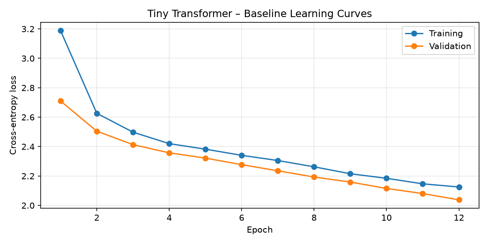
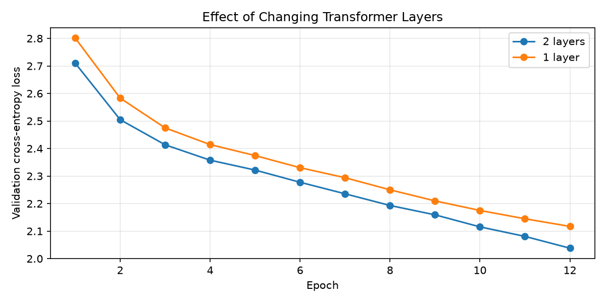
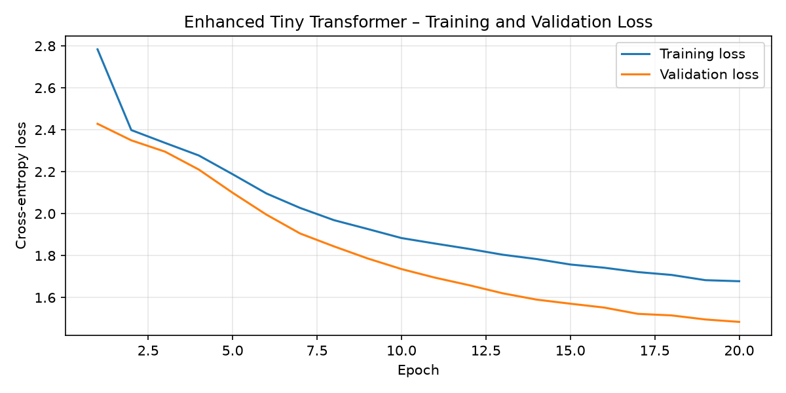

# Lab 03 — Developing a Tiny Transformer Language Model

**Module:** PUSL3205 — Large Language Models and Generative AI  
**Assessment:** P1 Individual Practical Portfolio  
**Tools:** Python, PyTorch, Hugging Face Datasets, Pandas, Matplotlib, Jupyter Notebook / VS Code  
**Dataset:** [roneneldan/TinyStories](https://huggingface.co/datasets/roneneldan/TinyStories)  


## 1. Laboratory Session and Objectives

This laboratory develops a **Tiny Transformer language model from scratch** to predict the next character in a sequence and generate text from a starting prompt. It covers dataset exploration, character-level tokenization, preparation of input–target sequences, Transformer architecture, training, evaluation, generation, model-setting experiments, and saving/reloading checkpoints.

Two notebooks document the work:

| Notebook | Purpose |
|---|---|
| [Lab 03 — Tiny Transformer](notebooks/lab03_tiny_transformer.ipynb) | Main implementation of the **11 required tasks**, including the 2-layer baseline and a 1-layer comparison. |
| [Lab 03 — Improvement Experiments](notebooks/lab03_improvement_experiments.ipynb) | Separate follow-up experiments with decoding settings, more data and training, a longer context, common held-out evaluation, and checkpoint verification. |

**Objectives**

- Understand the components of a causal Transformer and next-token (next-character) prediction.
- Build, train, evaluate, and save a working language model using PyTorch.
- Monitor training and validation losses and calculate **character-level perplexity**.
- Explore the effect of Transformer depth and improved training/generation settings.
- Critically assess generated-text quality alongside numerical evaluation metrics.

## 2. Tasks and Implementation

### Main laboratory: Tasks 1–11

| Task | Implementation |
|---|---|
| **1. Load and explore the dataset** | Loaded **600 TinyStories** examples; displayed sample stories and examined story lengths. |
| **2. Preprocess text** | Built a character-level tokenizer with character-to-ID and ID-to-character mappings. |
| **3. Prepare training data** | Created **64-character input sequences** and targets shifted by one character. |
| **4. Build the Transformer** | Used token and positional embeddings, **causally masked multi-head self-attention**, feed-forward layers, residual connections, layer normalization, and a language-model output head. |
| **5. Initialize the model** | Initialized a 2-layer model; used **cross-entropy loss** and the **AdamW** optimizer; checked tensor shapes and causal masking. |
| **6. Train the model** | Used forward passes, backpropagation, and optimizer updates over **12 epochs**. |
| **7. Monitor training** | Recorded and plotted training and validation cross-entropy losses. |
| **8. Evaluate** | Calculated held-out validation loss and **character-level perplexity**. |
| **9. Generate stories** | Sampled new characters from prompts including **“Once upon a time”** and **“The little boy”**. |
| **10. Change a model setting** | Compared **2-layer** and **1-layer** Transformers with the same basic data and training configuration. |
| **11. Save the model** | Saved parameters, vocabulary, configuration and metadata; successfully loaded the checkpoint and reproduced seeded generation. |

The architecture contains the core mechanisms discussed in the lectures: token/position embeddings, causal masking (preventing attention to future characters), multi-head attention, a feed-forward network, residual connections, and layer normalization. **GELU** is used inside the feed-forward network, and **dropout** is included in the model.

### Baseline configuration

| Setting | Value |
|---|---:|
| Loaded stories | 600 |
| Training / validation stories | 540 / 60 (story-level split from the selected training examples) |
| Vocabulary size | 74 character IDs, including an unknown-character ID |
| Context length | 64 characters |
| Embedding dimension | 64 |
| Attention heads | 2 |
| Transformer layers | 2 |
| Feed-forward dimension | 128 |
| Batch size | 16 |
| Epochs / updates per epoch | 12 / 50 |
| Learning rate | 0.001 |
| Dropout | 0.10 |
| Optimizer / loss | AdamW / cross-entropy |
| Trainable parameters | **80,714** |

The model was trained on a CPU in the recorded notebook run (`PyTorch 2.15.0+cpu`). The code selects CUDA if a supported GPU is available.

## 3. Results and Supporting Evidence

### 3.1 Baseline training and evaluation

Across 12 epochs, the baseline training loss decreased from **3.1885 to 2.1253**, and validation loss decreased from **2.7102 to 2.0380**. Both curves continued to decrease at the end of training, with no clear sign of overfitting in this run.

| Baseline result | Value |
|---|---:|
| Final training loss | **2.1253** |
| Final validation loss | **2.0380** |
| Character-level perplexity | **7.6751** |



### 3.2 Experiment: one versus two Transformer layers

With the same 12-epoch training schedule, the **2-layer model** achieved lower validation loss and perplexity than the **1-layer model**. The 1-layer model was smaller, illustrating the performance–complexity trade-off.

| Model | Parameters | Validation loss | Character-level perplexity |
|---|---:|---:|---:|
| **2 layers (baseline)** | 80,714 | **2.0380** | **7.6751** |
| 1 layer (experiment) | 47,242 | 2.1170 | 8.3064 |



### 3.3 Generated story quality

The baseline model generated recognizable words and some sentence-like fragments, but also invented words, repetition, grammatical errors, and incoherent narrative sequences.

**Baseline excerpt:**

> Once upon a time. He ging he sed canle so sherand buld...

This shows successful *autoregressive character generation*, but **not** successful production of a consistently meaningful story.

### 3.4 Additional improvement experiments

The second notebook investigates the original model's decoding settings before training a new, enhanced 2-layer Transformer. The **larger 3-layer architecture was not run**.

**Experiment A — decoding changes.** Four combinations of temperature and top-k were tested on the saved baseline without changing its weights: `(0.8, 10)`, `(0.5, 5)`, `(0.6, 5)`, and `(0.7, 10)`. Lower temperature sometimes produced more predictable text, but repetition and invented words remained. Decoding changes alone did not solve the language-quality problem.

**Experiment B — enhanced training.** A new model used **2,000 training stories** from TinyStories and **100 stories from the dataset's official validation split**, with a longer context and more optimization updates. Gradient clipping was also applied during training.

| Setting | Enhanced model |
|---|---:|
| Training / validation stories | 2,000 / 100 |
| Vocabulary size | 81 IDs, including unknown-character ID |
| Context length | 128 characters |
| Transformer layers / attention heads | 2 / 2 |
| Embedding / feed-forward dimensions | 64 / 128 |
| Batch size | 16 |
| Epochs / updates per epoch | 20 / 150 |
| Learning rate / dropout | 0.001 / 0.10 |
| Trainable parameters | **85,713** |
| Final training loss | **1.6777** |
| Final validation loss (128-character evaluation) | **1.4837** |
| Character-level perplexity (128-character evaluation) | **4.4094** |



**Common held-out evaluation.** For a more consistent comparison, both the original and enhanced models were evaluated using the **same official TinyStories validation text**, the **same selected validation windows**, and a shared **64-character evaluation context**:

| Model | Common validation loss ↓ | Character-level perplexity ↓ | Parameters |
|---|---:|---:|---:|
| Original 2-layer baseline | 2.0662 | 7.8948 | 80,714 |
| **Enhanced 2-layer model** | **1.5160** | **4.5539** | 85,713 |

The enhanced model performed better on this common evaluation. However, **multiple factors changed together** (training data volume, training updates, context length, and vocabulary), so this experiment does **not** establish which individual change caused the improvement.

**Enhanced generation excerpt:**

> Once upon a time. He says a with they was a pred. She saw the she wanted...

The enhanced output contained more recognizable phrases, such as **“She saw”**, but still showed invented words, repetition and limited coherence. **Lower perplexity does not guarantee a meaningful story.**

### 3.5 Model saving and verification

Both notebooks saved PyTorch checkpoints containing model weights, architecture settings and vocabulary information. Reload tests **passed**, reproducing the generated text with the same prompt and random seed.

### 3.6 Files produced by the notebooks

**Main notebook results**

- [Story length distribution](results/story_length_distribution.png)
- [Baseline loss curves](results/baseline_loss_curves.png)
- [Baseline training history (CSV)](results/baseline_training_history.csv)
- [Baseline generated stories (TXT)](results/baseline_generated_stories.txt)
- [1-layer training history (CSV)](results/onelayer_training_history.csv)
- [Layer comparison figure](results/model_settings_comparison.png)
- [Layer comparison metrics (CSV)](results/model_settings_comparison.csv)
- [Layer comparison generated stories (TXT)](results/settings_generated_stories.txt)

**Improvement notebook results**

- [Baseline decoding comparisons (CSV)](results/improvement_experiments/baseline_decoding_comparison.csv)
- [Enhanced training history (CSV)](results/improvement_experiments/enhanced_2000stories_20epochs_training_history.csv)
- [Enhanced loss curves](results/improvement_experiments/enhanced_2000stories_20epochs_loss_curves.png)
- [Baseline versus enhanced generations (CSV)](results/improvement_experiments/enhanced_2000stories_20epochs_generation_comparison.csv)
- [Common held-out evaluation (CSV)](results/improvement_experiments/enhanced_2000stories_20epochs_common_validation_comparison.csv)

**Checkpoints and configuration**

- `checkpoints/tiny_transformer_checkpoint.pt` — original 2-layer baseline
- `checkpoints/model_config.json` — human-readable original configuration
- `checkpoints/improvement_experiments/enhanced_2000stories_20epochs.pt` — enhanced model


## 4. Observations and Reflection

- The decreasing training and validation losses showed that both original configurations learned next-character patterns, although their generated stories were not coherent.
- Two Transformer layers achieved better validation loss and perplexity than one layer, but required more parameters.
- Changing temperature and top-k altered the style and repetition of output; it could not compensate fully for limited training.
- The enhanced training run substantially improved next-character prediction metrics and produced more recognizable word sequences, while still falling short of natural, meaningful storytelling.
- Character-level modelling is challenging because the model must learn spelling, word boundaries, grammar and story structure from individual characters.
- Perplexity describes next-character prediction under a particular evaluation protocol; it is **not** a direct measure of story quality. Results from different evaluation splits, vocabularies or context lengths should not be compared as though they were identical.

**Possible future improvements (not implemented):** More systematic single-variable experiments, additional training data, learning-rate tuning, subword tokenization, and a larger architecture with sufficient computing resources.

## 5. Learning Outcomes

Through these practicals, I gained experience in building Transformer components in PyTorch, implementing causal masking and next-character targets, training with cross-entropy and AdamW, evaluating validation loss and perplexity, experimenting with architecture and decoding settings, comparing models fairly, and saving/reloading checkpoints. The key lesson was that **improvements in numerical loss do not automatically translate into fluent or coherent generated language**.

## 6. How to Run the Notebooks in VS Code

From the **`LLM-Practical-Portfolio` repository root** on Windows PowerShell:

```powershell
# If you already have a working .venv, do not recreate it.
py -m venv .venv

# Install dependencies into the project environment.
.\.venv\Scripts\python.exe -m pip install torch datasets pandas matplotlib ipykernel
```

1. In VS Code, open `notebooks/lab03_tiny_transformer.ipynb` inside `Lab-03-Tiny-Transformer` and select the repository's `.venv` Python kernel.
2. Run all cells in order to reproduce the baseline, 1-layer comparison and original checkpoint.
3. Open `notebooks/lab03_improvement_experiments.ipynb` with the same kernel. The original checkpoint must exist at `checkpoints/tiny_transformer_checkpoint.pt` to run the baseline decoding experiment and common baseline comparison.
4. Keep `QUICK_TEST = False` to reproduce the full enhanced run. The notebook loads its training and validation examples from Hugging Face (an internet connection is needed for the initial download).
5. Review the generated `results/` and `checkpoints/` files; compare the model outputs and confirm the reload checks show `PASSED`.

**Practical notes:** Training can run on CPU but may take longer. Do not commit `.venv/`, credentials or unrelated large caches. Use `git status` to review generated files before pushing them. For reliable results, restart the kernel and execute notebooks from top to bottom after changing configuration settings.

## 7. References and Attribution

- PUSL3205, **Lab Sheet 3: Developing a Tiny Transformer Language Model** (lecturer-provided practical guidelines).
- Lecturer-provided example files: `tiny_transformer_llm.py` and `transformer_practice.py` (reference implementations adapted into the practical workflow).
- [TinyStories dataset — Hugging Face](https://huggingface.co/datasets/roneneldan/TinyStories).
- [PyTorch documentation](https://pytorch.org/docs/stable/index.html) — Transformer components, optimization and model serialization.


